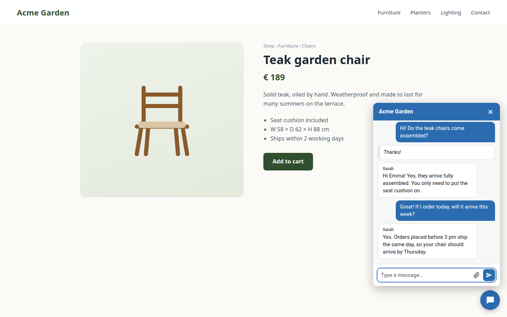
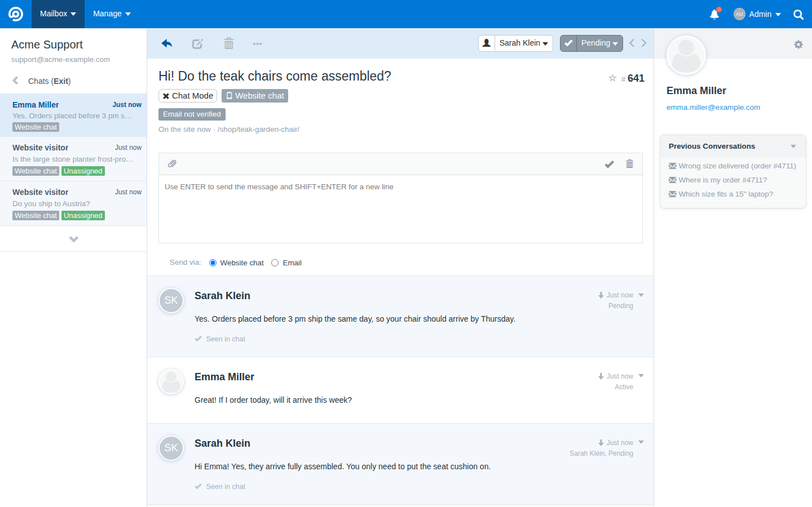
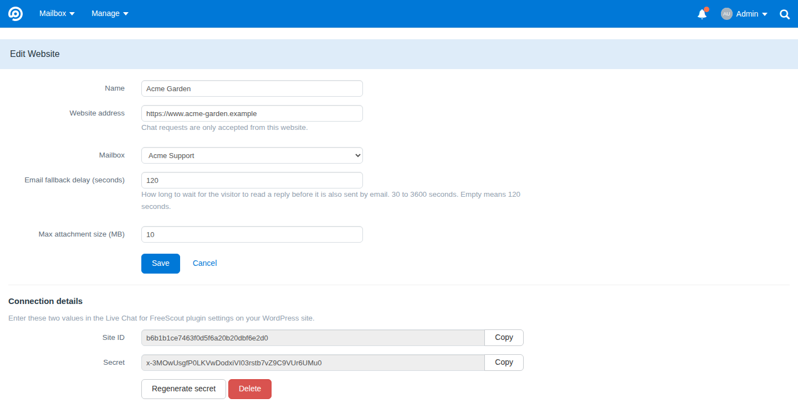
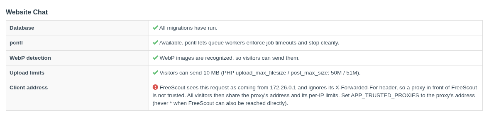

# Website Chat (WordPress)

Live chat from WordPress websites as a channel for [FreeScout](https://freescout.net).

This is the FreeScout half of the chat. The visitor-facing half is the WordPress plugin
[Live Chat for FreeScout](https://github.com/automaze-me/live-chat-for-freescout), which shows
the chat widget on your website and talks to this module. A visitor's chat becomes a FreeScout conversation; agents reply from FreeScout as usual.
A reply the visitor does not see in the chat within a short delay is sent to them by email, with
a link that reopens the chat.

## Screenshots

What a visitor sees: the Live Chat for FreeScout plugin shows the chat on a product page. The
visitor left an email address, and the agent's replies arrive in the chat window.



The same chat in FreeScout, in chat mode. The labels show the channel and how far the visitor is
identified ("Email not verified"), and the line below them shows the page the visitor is on. Under
the editor you choose whether a reply goes to the chat or out by email. "Seen in chat" marks the
replies the visitor has read.



**Manage → Website Chat** holds one entry per website: its address, the mailbox its chats land in,
the email fallback delay and the attachment limit. The Site ID and the secret go into the
WordPress plugin.



**System → Status** checks the setup. Here it warns that FreeScout sits behind a proxy it does not
trust, so all visitors would share one set of per-IP limits.



## Requirements

A standard FreeScout installation covers almost everything. On top of that, the chat needs:

- FreeScout 1.8.248 or newer, on PHP 7.1.2 or newer.
- FreeScout reachable from the internet over HTTPS. Visitors' browsers talk to FreeScout directly,
  and an HTTPS website cannot call a plain-HTTP address.
- FreeScout seeing each visitor's own IP address. Behind a reverse proxy or CDN, set
  `APP_TRUSTED_PROXIES`; otherwise all visitors share one set of [abuse limits](#abuse-limits).
  The "Client address" row in System → Status shows what FreeScout sees.

## Installation

1. Download `WordPressChat.zip` from the
   [latest release](https://github.com/automaze-me/freescout-wordpresschat/releases/latest) and
   extract it into your FreeScout `Modules/` directory. The zip already contains the
   `WordPressChat/` folder.
2. Activate the module in **Manage → Modules**. FreeScout links the module's assets into
   `public/modules/wordpresschat` when it installs or activates the module. If that folder does
   not exist, the chat's stylesheet and scripts are not served.
3. Run the module's migrations. The command takes the module's name from `module.json`:

   ```bash
   php artisan module:migrate "Website Chat (WordPress)"
   ```

   If your `Modules` folder is a symlink to a location outside the FreeScout directory (as in
   some Docker setups), FreeScout skips module migrations without saying so. Use **System →
   Tools → Migrate DB** instead.
4. Restart the queue workers so they load the module: `php artisan queue:restart`.

Until the migrations have run, the chat API answers `503 maintenance` with `Retry-After: 300`,
**Manage → Website Chat** shows only a notice to open System → Tools and click Migrate DB, and the
hourly cleanup does nothing.

## Updating

Replace the `WordPressChat/` folder with the new release, then repeat steps 3 and 4 of the
installation: run the migrations and restart the queue workers. The module also broadcasts a
queue restart by itself the first time it loads after its version changed, but restarting the
workers yourself does no harm.

After restoring a database backup, run `php artisan cache:clear`: a cached "migrations done"
result survives a restore that lost migration rows.

After you update the WordPress plugin, purge your website's page cache. A cached page still holds
the old widget configuration, so new texts and settings only appear once the page is
regenerated.

## Connecting a website

1. In FreeScout, open **Manage → Website Chat** (administrators only) and add a website:
   - **Name** – shown in the list.
   - **URL** – the website's address, for example `https://www.example.com`. Its origin
     (scheme, host and port) is the only origin allowed to use the chat API, and the "continue
     this chat" links in emails point to it. A domain with non-Latin letters (for example
     `https://www.bücher.example`) needs PHP's `intl` extension.
   - **Mailbox** – where the website's conversations land.
   - **Email fallback delay** – seconds before an unseen reply goes out by email (30 to 3600;
     default 120).
   - **Max attachment size** – in MB (1 to 50; default 10). PHP's limits can lower it, see
     [Upload limits](#upload-limits).
2. Open the website entry. It shows the **Site ID** and the **secret**.
3. Install the WordPress plugin: download `live-chat-for-freescout.zip` from the plugin's
   [latest release](https://github.com/automaze-me/live-chat-for-freescout/releases/latest) and
   upload it under **Plugins → Add New Plugin → Upload Plugin**. Later versions arrive through
   WordPress's own updates.
4. In WordPress, open **Settings → Live Chat for FreeScout**, enter the FreeScout URL, the Site ID
   and the secret, and save.
5. Click **Test connection**. It tells you whether FreeScout knows the Site ID, whether the secret
   matches, and whether the website's address matches the origin saved in FreeScout.

The secret is what lets the plugin vouch for logged-in WordPress users and order numbers. If you
leave it out, visitors can still chat, but they are not recognised. Regenerating the secret in
FreeScout stops the plugin until you enter the new one.

**System → Status** has a "Website Chat" block that checks the database, `pcntl`, WebP support,
the upload limits and the client address FreeScout sees.

## How replies reach visitors

The visitor sees an agent's reply in the chat widget, which polls for new messages and reports
back when a reply has been seen.

A reply the visitor has not seen within the website's fallback delay goes out as one email to the
conversation's customer. The email carries a "continue this chat" link to the website. The widget
redeems it only on an explicit click by the visitor.

No link is included, and the email still goes out, when it would also reach other people: when the
reply has a Cc or Bcc, or when the mailbox has an automatic Bcc. The link is only
ever sent to the conversation's own address, so it does not go to anyone else.

A fallback email that cannot be sent is tried up to five times over about 2 hours 20 minutes, like
core's replies. If it still fails, the agent sees a short reason in the conversation ("the mail
server refused the login (SMTP 535)", say); the log keeps the full error.

Agents can also choose **Email** in the reply picker above the Send button to send a particular
reply by email at once.

If an email cannot be delivered because the mail server refuses the visitor's address at send time,
the agent sees a red notice in the conversation ("Email to the visitor failed: the mail server
refused the visitor's address") instead of a "sent" status.

### Merging website chats

Merging two website chats from different visitors keeps each visitor's chat private. A reply sent
before the merge that had not reached its visitor shows a red notice in the merged conversation
instead of going to the other visitor. Replies written in the merged conversation afterwards go to
the target conversation's visitor.

## Upload limits

Visitors can send images (JPEG, PNG, GIF, WebP) and PDF files. The limit is the website's
**Max attachment size**, capped by PHP's `upload_max_filesize` and `post_max_size`. System →
Status shows the limit that applies and warns when PHP is lower than the website's setting.

The web server has a limit of its own, and it has to be at least as large as `post_max_size`:
`client_max_body_size` in nginx, `LimitRequestBody` in Apache. If it is lower, the web server
rejects the upload before PHP sees it, and the visitor gets a generic error instead of a message
that the file is too large.

## Abuse limits

The chat API limits how often one visitor and one IP address can call it. The counters are kept
in the database. A request over a limit gets `429` with a `Retry-After` header, and the widget
shows "Too many messages in a short time". Every attempt counts, including refused ones. When
several limits refuse a request, `Retry-After` is the longest wait. Once an IP limit has refused a
request, the per-token limits no longer count it.

- **Starting a chat** (a message without a chat token): 10 per hour per IP address.
- **Messages**: 20 per minute per chat token, and 60 per minute per IP address.
- **Uploads**: 50 MB per hour per chat token, and 200 MB per hour per IP address.
- **Identifying by email or order number**: 5 per 15 minutes per chat token, and 10 per 15
  minutes per IP address.
- **WordPress login handover**: 60 per 15 minutes per IP address.
- **Continue links**: 10 per 15 minutes per IP address.
- **Marking replies as seen**: 60 per minute per chat token, and 180 per minute per IP address.
- **Attachment downloads**: 120 per minute per chat token, and 360 per minute per IP address.
- **Log out**: 30 per minute per IP address.
- **Test connection** from the plugin: 10 per minute per IP address.

Polling for new messages is not limited, and neither are browser preflight requests. Every open chat
polls, so leave room for that in any rate limiting you do in the web server or a CDN.

A message that fills in the hidden `hp` field is refused as a bot and not stored.

Visitors behind one shared IP address (an office, a mobile carrier) share the per-IP limits.

The per-IP limits need FreeScout to see each visitor's own address. Otherwise every visitor seems
to come from the same address, and a few busy visitors lock out everyone else.

- **Reverse proxy or CDN:** set `APP_TRUSTED_PROXIES` in FreeScout's `.env` to the proxy's
  addresses (comma-separated), and only those, then run `php artisan config:clear`. Never use `*`
  on a FreeScout that can also be reached directly: it trusts the `X-Forwarded-For` header of any
  client, so anyone could pretend to come from any address.
- **Containers:** port forwarding that rewrites the source address has the same effect. Rootless
  Podman with slirp4netns and the rootlesskit port handler does this: FreeScout then sees
  `10.0.2.100` for everyone. Use port forwarding that keeps the client address, or put a proxy in
  front that passes it on (and trust that proxy as above).

To check, open **System → Status** from outside your network. The "Client address" row shows the
address FreeScout sees for your own request and warns when it is a private address or when a
proxy's `X-Forwarded-For` header is ignored.

## Origin check limits

The API accepts browser requests only from the website's origin as saved in FreeScout. The origin
is compared exactly, after lowercasing, dropping default ports and converting international
domain names to punycode (this needs PHP's `intl` extension).

- Each website entry has **one** origin. `example.com` and `www.example.com` are different
  origins. A site reachable under several domains needs one website entry for each, with its own
  Site ID and secret, and the plugin on each domain configured with its own.
- A reverse proxy or CDN in front of FreeScout that terminates TLS must pass the browser's
  `Origin` header on unchanged. If it removes or rewrites the header, every request fails with
  `403 origin`.
- Requests without an `Origin` header (server-to-server calls) are not subject to the check.

## Privacy

The module stores what a chat needs and little else:

- the chat messages and their attachments, as FreeScout conversations and threads;
- the visitor's email address, when they give one or when WordPress vouches for the logged-in
  user, or the link to the customer found through an order number;
- the page path the visitor is on, so agents can see "On the site now" with the path. The query
  string and the fragment are never kept;
- chat session tokens only as SHA-256 hashes;
- rate-limit counters, which are keyed by HMAC-SHA256 hashes (made with the app key) of the IP
  address (or the token) and are purged by the hourly cleanup once they have expired. IPv6 addresses
  are folded to their first 64 bits first. The module stores no raw IP addresses. Rotating `APP_KEY`
  resets the counters.

## Channel code

The module registers communication channel **106**. This code is provisional until the FreeScout
team confirms it. Codes below 100 belong to official modules, and community modules use 100 and
above.

## Testing

The suite runs inside a FreeScout development installation, against a database for the `testing`
connection (see `config/database.php`). The module has to be active in that database, and the
suite refuses to run against any other connection. From the FreeScout root:

```bash
vendor/bin/phpunit -c Modules/WordPressChat/phpunit.xml
```

In the FreeScout development setup that runs in Docker:

```bash
docker compose exec -T --user www-data app ./vendor/bin/phpunit -c Modules/WordPressChat/phpunit.xml
```

## License

MIT, see [LICENSE](LICENSE).
